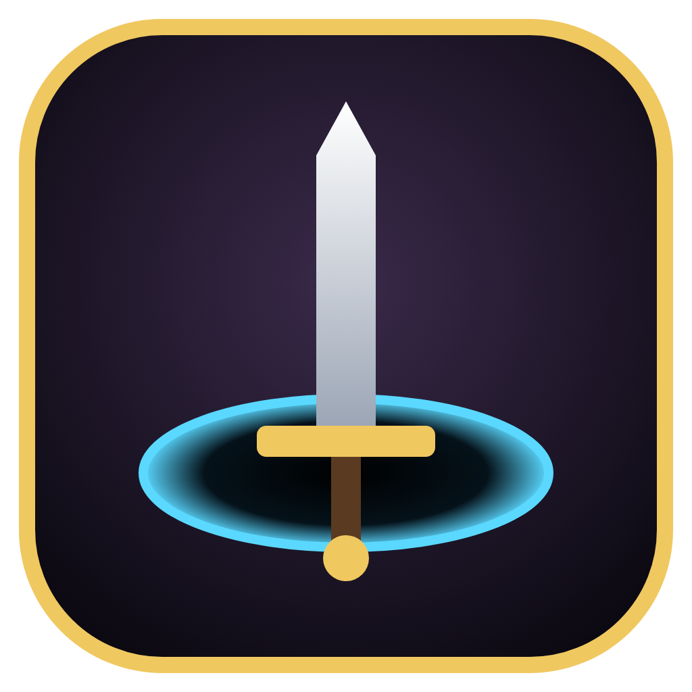

# Depthwarden

A 3D roguelite dungeon crawler for **Windows** and **macOS** (Linux too). Every floor is a procedurally generated dungeon. Fight through it, find treasure, pick a new perk each time you level up, and go deeper. When you die, the gold you carried is banked, and you can spend it in the Armory on permanent upgrades for your next run.



---

## Install

### Windows

1. **[Download Depthwarden-Setup.exe](https://github.com/davidrowell11/game/releases/latest/download/Depthwarden-Setup.exe)**
2. Double-click it. The game installs and starts on its own. There's nothing to click through.
   - If Windows shows **"Windows protected your PC"**, click **More info**, then **Run anyway**. This appears because the game isn't signed with a paid certificate.
3. To play again later, use the **Depthwarden** shortcut on your Desktop or in the Start Menu.

To uninstall: Settings → Apps → Depthwarden → Uninstall.

### Mac (Apple Silicon and Intel)

1. **[Download Depthwarden-mac.dmg](https://github.com/davidrowell11/game/releases/latest/download/Depthwarden-mac.dmg)**
2. Double-click it, then drag **Depthwarden** onto the **Applications** folder in the window that opens.
3. **The first time only:** in Applications, **right-click** Depthwarden → **Open** → **Open**. After that, it opens normally.
   - On macOS 15 or newer, if there's no **Open** button: try to open the app once, then go to **System Settings → Privacy & Security** and click **Open Anyway**.
   - If it says the app **"is damaged"**, open **Terminal**, paste this, and press Enter:
     ```bash
     xattr -cr /Applications/Depthwarden.app
     ```

To uninstall: drag Depthwarden from Applications to the Trash.

### Linux

**[Download Depthwarden-linux.AppImage](https://github.com/davidrowell11/game/releases/latest/download/Depthwarden-linux.AppImage)**, right-click it → Properties → allow it to run as a program, then double-click it.

All downloads are also listed on the [Releases page](https://github.com/davidrowell11/game/releases/latest).

### System requirements

- Windows 10/11 (64-bit), macOS 11 Big Sur or newer, or a modern 64-bit Linux
- Any GPU with WebGL 2 support (integrated graphics from the last ~8 years is fine)
- About 300 MB of disk space

---

## How to play

| Input | Action |
| --- | --- |
| **WASD** / Arrow keys | Move |
| **Mouse** | Aim |
| **Left mouse** (hold) | Sword sweep (also knocks enemy projectiles out of the air) |
| **Right mouse** (hold) | Arcane bolt (ranged) |
| **Space** / **Shift** | Dash (you can't be hit during a dash) |
| **E** | Interact: open chests, pray at shrines, descend stairs |
| **Q** | Drink a health potion |
| **Tab** | Toggle the full map |
| **Esc** / **P** | Pause (volume setting is here) |
| **F11** | Fullscreen |
| **1 / 2 / 3** | Pick a perk on the level-up screen |

**The loop**

- **Every floor is generated** from the run seed. Rooms are joined by corridors, and some corridors loop back on themselves. Floors get larger and more dangerous as you go down.
- Find the **glowing portal** (shown in blue on the minimap) and press **E** to go down.
- Every **4th floor** is a **Guardian** floor. The portal stays sealed (red) until the boss dies. Beat the guardian of **floor 12** to win. After that, you can keep descending in endless mode.
- Rooms come in different shapes: halls, round chambers, crosses and twisting caverns.
- **Gold chests** give you a free perk. **Green shrines** heal you and raise your max health.
- From floor 2, a **Wandering Merchant** (purple on the minimap) may set up shop. Spend the gold you've collected this run on potions, a full heal or extra perks. Gold you spend is gold you won't bank.
- **Smash urns** with your sword or bolts for gold, potions and XP. Watch out for **spike traps**: they rattle just before they fire, they hurt monsters too, and you can dash across them safely.
- Enemies drop **XP crystals** (green), **gold** and sometimes **potions**. When you level up, pick 1 of 3 random perks: split bolts, lifesteal, thorns, crits, and more.
- **Elite** enemies are bigger, glow orange, and drop better loot.
- When you die, all gold you carried is **banked**. Spend it in the **Armory** on the main menu on permanent upgrades: Vitality, Might, Swiftness, Fortune, Satchel, Second Wind.
- **Seeds:** type a seed on the main menu to replay the same dungeon layouts, or to share a run with a friend. Leave it blank for a random run.

**Enemies:** Husks (melee), Spitters (ranged), Brutes (they telegraph, then charge, and are stunned if they hit a wall), Bloaters (they swell up and explode, and also burst when killed, so lure them into groups), Wisps (fast swarmers), Bone Shamans (summon Husks), and the Hollow Warden boss (bullet novas, aimed fans, ground slams and summons; below 50% health it gets enraged and adds spiral bullet streams).

Your progress is saved automatically here:
- Windows: `%APPDATA%\Depthwarden`
- macOS: `~/Library/Application Support/Depthwarden`
- Linux: `~/.config/Depthwarden`

---

## Build from source

You need **Node.js 20 or newer** ([nodejs.org](https://nodejs.org)).

```bash
git clone https://github.com/davidrowell11/game.git
```
```bash
cd game
```
```bash
npm install
```

Run the game in a desktop window:

```bash
npm start
```

Or play it in your browser with live reload while you change the code (opens on http://localhost:5173):

```bash
npm run dev
```

Run the tests (they check that every generated dungeon is fully connected and spawns things in valid places):

```bash
npm test
```

### Build the installers yourself

Each command must run on that operating system:

```bash
npm run dist:win
```
```bash
npm run dist:mac
```
```bash
npm run dist:linux
```

The installers are written to the `release/` folder.

### Automatic builds and releases

The GitHub Actions workflow (`.github/workflows/build.yml`) builds the Windows, macOS and Linux installers on every push to `main`. It then publishes them to a release named after the `version` in `package.json` (for example `v1.0.0`). Later pushes refresh that release's files. To publish a new version, change `version` in `package.json` (for example to `1.0.1`) and push to `main`.

---

## Project layout

```
src/
  dungeon.js    Procedural generator: room placement, MST + loop corridors, room roles, spawns
  rng.js        Seeded random number generator (every floor is reproducible)
  world.js      Turns the grid into 3D geometry; collision, line of sight, path-finding, fog of war
  game.js       Game loop, combat, floors, interactables, state machine
  player.js     Player model, stats and animation
  enemies.js    Enemy types, models and AI (including the boss patterns)
  perks.js      Level-up perks and base stats
  save.js       Persistent gold and Armory upgrades
  effects.js    Particles, projectiles, pickups, damage numbers
  props.js      Spike traps, breakable urns, the merchant
  ui.js         HUD, minimap, menus
  audio.js      Sound effects synthesised at runtime (no audio files)
  textures.js   Procedural textures (no image files)
electron/       Desktop window wrapper
build/          App icon and macOS signing hook
test/           Dungeon generator tests
```

Built with [Three.js](https://threejs.org), [Electron](https://www.electronjs.org) and [electron-builder](https://www.electron.build). All art, textures and sounds are generated in code.
